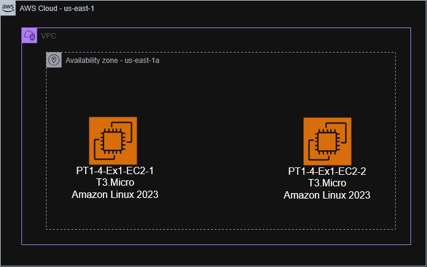

# practiquescloud.Rafael
Pt1.4 EC2 amb Terraform - Inicial

# Práctica 1.4 - Ejercicio 1: Primeras instancias EC2 con Terraform

## Descripción del proyecto
Este ejercicio consiste en la creación automatizada de 2 instancias EC2 de tipo `t3.micro` con sistema operativo Amazon Linux 2023 en la región `us-east-1` de AWS utilizando Infraestructura como Código (IaC) con Terraform.

## Topología de Red


## Procedimiento paso a paso
1. **Configuración de credenciales:** Se han configurado las credenciales temporales del laboratorio de AWS Academy en el archivo `~/.aws/credentials`.
2. **Definición de la infraestructura (`main.tf`):**
  
   - Se ha declarado el proveedor de AWS configurado en la región `us-east-1`.
   - Se han definido variables para parametrizar la región, el tipo de instancia (`t3.micro`) y la cantidad (`2`).
   - Se ha utilizado un bloque `data "aws_ami"` para obtener dinámicamente la última imagen oficial de Amazon Linux 2023.
   - Se ha creado el recurso `aws_instance` utilizando el argumento `count` para desplegar ambas máquinas virtuales (`PT1-4-Ex1-EC2-1` y `PT1-4-Ex1-EC2-2`).

3. **Despliegue y verificación:** Se ha inicializado el directorio de trabajo, comprobado el plan de ejecución y aplicado los cambios verificando las instancias desde la consola de AWS.

## Instrucciones de ejecución de Terraform

```bash
# 1. Inicializar el directorio de trabajo y descargar el proveedor de AWS
terraform init

# 2. Comprobar el plan de ejecución antes de aplicar cambios
terraform plan

# 3. Desplegar las 2 instancias EC2 en AWS
terraform apply

# 4. Eliminar los recursos creados una vez finalizadas las pruebas
terraform destroy