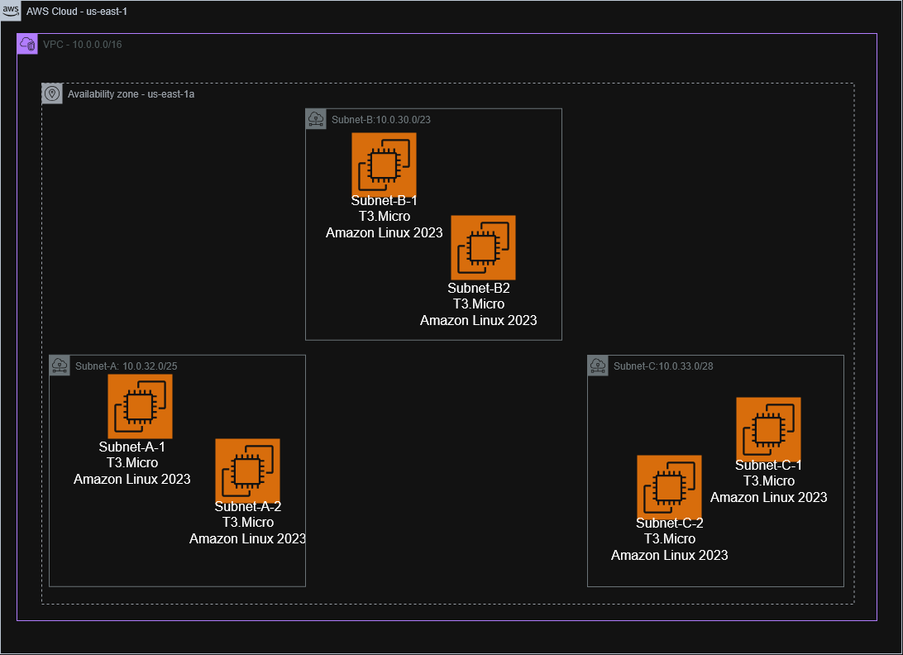
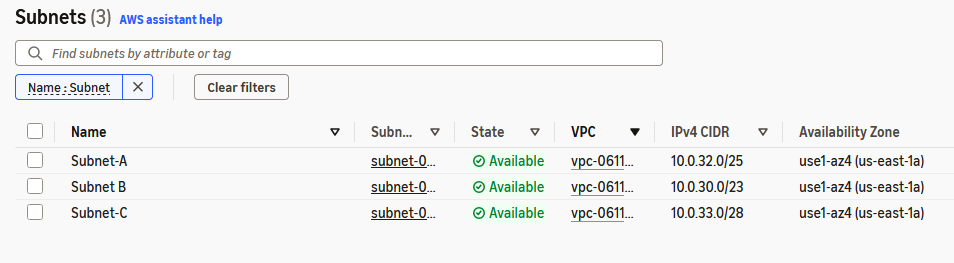
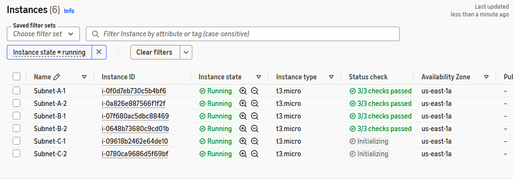

# practiquescloud.Rafael
Pt1.4 EC2 amb Terraform - Inicial
# Práctica 1.4 - Ejercicio 2: Diseño y Despliegue de VPC, Subredes y EC2

## Descripción del proyecto
Este ejercicio consiste en la creación de una VPC personalizada (`10.0.0.0/16`) con 3 subredes en la zona de disponibilidad `us-east-1a` y el despliegue de 2 instancias EC2 `t3.micro` (Amazon Linux 2023) en cada una (6 en total), comparando el despliegue manual desde la consola de AWS con la automatización mediante Terraform.

## Topología de Red


## Despliegue Manual (Consola de AWS)
### Creación de la VPC y las 3 Subredes


### Listado de las 6 instancias EC2 en ejecución


## Procedimiento paso a paso
1. **Despliegue manual (GUI):** Se ha creado manualmente la VPC (`10.0.0.0/16`), las tres subredes (`10.0.32.0/25`, `10.0.30.0/23` y `10.0.33.0/28`) en `us-east-1a` y 2 instancias EC2 `t3.micro` dentro de cada subred.
2. **Limpieza manual:** Se han eliminado las instancias, subredes y la VPC creadas manualmente antes de automatizar el entorno.
3. **Automatización con Terraform (`main.tf`):** Se ha definido la VPC, el mapa de subredes con bucles `for_each` y las 6 instancias EC2, validando y desplegando toda la infraestructura mediante código.

## Instrucciones de ejecución de Terraform

```bash
# 1. Inicializar el directorio de trabajo y descargar el proveedor de AWS
terraform init

# 2. Comprobar el plan de ejecución antes de aplicar cambios
terraform plan

# 3. Desplegar la VPC, las 3 subredes y las 6 instancias EC2
terraform apply

# 4. Eliminar todos los recursos creados una vez finalizadas las pruebas
terraform destroy