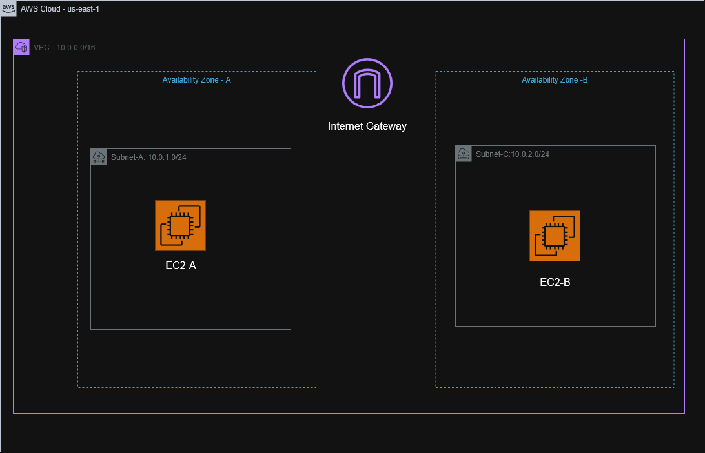
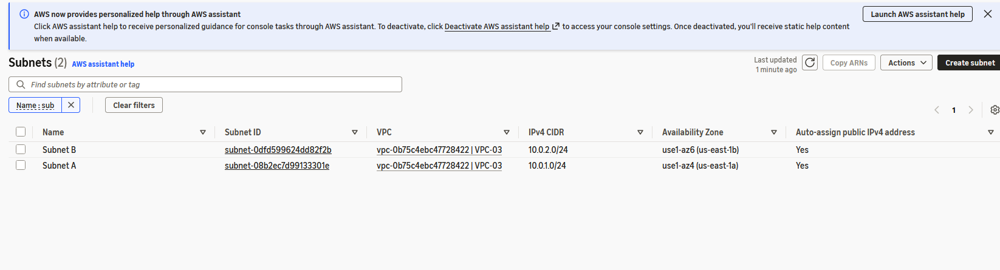
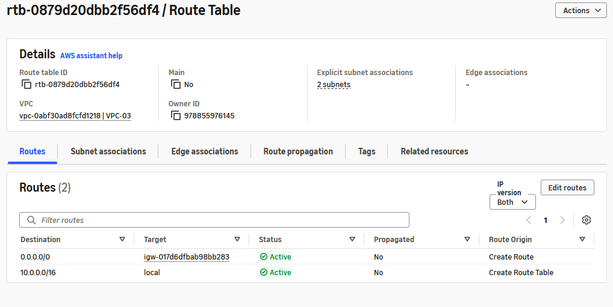
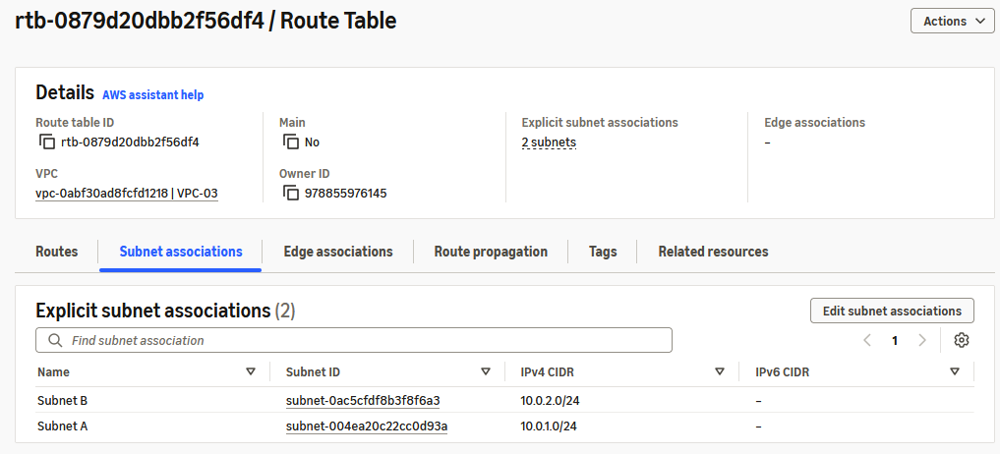
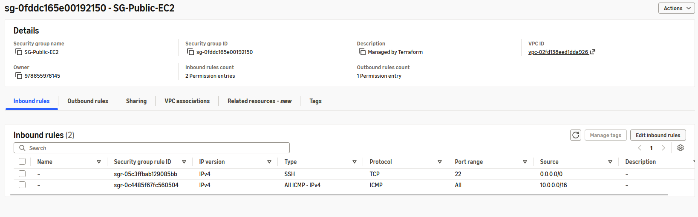
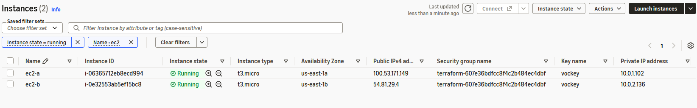
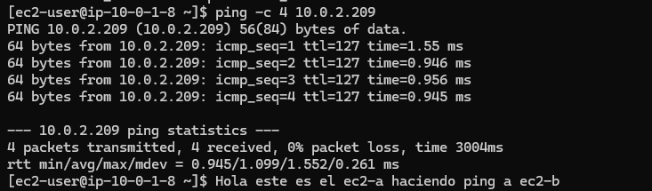
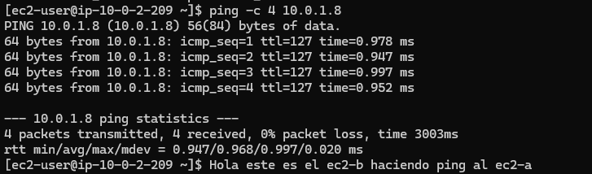
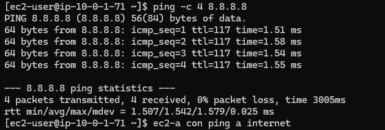
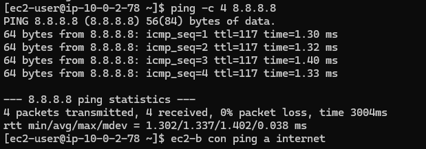

# Práctica 2.2 — Despliegue de Infraestructura Básica en AWS con Terraform

Despliegue automatizado mediante **Terraform** (`main.tf`) en la región **`us-east-1`** de una red virtual privada (**VPC**) con dos subredes en distintas zonas de disponibilidad, salida a Internet mediante **Internet Gateway**, control de tráfico con **Security Groups** y dos instancias **EC2** comunicadas entre sí.

---

## Arquitectura Desplegada



- **Región AWS:** `us-east-1`
- **VPC (`VPC-03`):** Bloque CIDR `10.0.0.0/16`
- **Subredes (`Subnet A` y `Subnet B`):**
  - `Subnet A`: `10.0.1.0/24` en `us-east-1a` con asignación automática de IPv4 pública activada.
  - `Subnet B`: `10.0.2.0/24` en `us-east-1b` con asignación automática de IPv4 pública activada.

- **Enrutamiento (`rtb-0879d20dbb2f56df4` e `igw-017d6dfbab98bb283`):** Internet Gateway asociado a `VPC-03` y tabla de rutas con salida por defecto (`0.0.0.0/0`) vinculada explícitamente a ambas subredes.


- **Seguridad (`SG-Public-EC2`):**
  - **Entrada (Ingress):** SSH (`TCP/22`) abierto a `0.0.0.0/0` y tráfico `ICMP` restringido exclusivamente al rango interno de la VPC (`10.0.0.0/16`).
  - **Salida (Egress):** Todo el tráfico permitido hacia `0.0.0.0/0`.

- **Instancias EC2 (`ec2-a` y `ec2-b`):** Dos instancias `t3.micro` desplegadas una en cada zona de disponibilidad (`us-east-1a` y `us-east-1b`), con IP pública asignada y accesibles mediante el par de claves `vockey`.


**Prueba de conectividad:** Se ha verificado la comunicación entre ambas instancias mediante `ping` y `ssh`, confirmando que el tráfico ICMP está permitido únicamente dentro del rango de la VPC.

## Muestra de conectividad entre instancias EC2 y hacia Internet

### Prueba de conectividad EC2s

| Desde `ec2-a` hacia `ec2-b` | Desde `ec2-b` hacia `ec2-a` |
| :---: | :---: |
|  |  |

---

### Prueba de conectividad a internet

| Salida a Internet desde `ec2-a` | Salida a Internet desde `ec2-b` |
| :---: | :---: |
|  |  |

## Instrucciones de Despliegue

```bash
# 1. Inicializar proveedores de Terraform
terraform init

# 2. Previsualizar el plan de ejecución
terraform plan

# 3. Desplegar la infraestructura en AWS
terraform apply

# 4. Destruir los recursos al finalizar las pruebas
terraform destroy